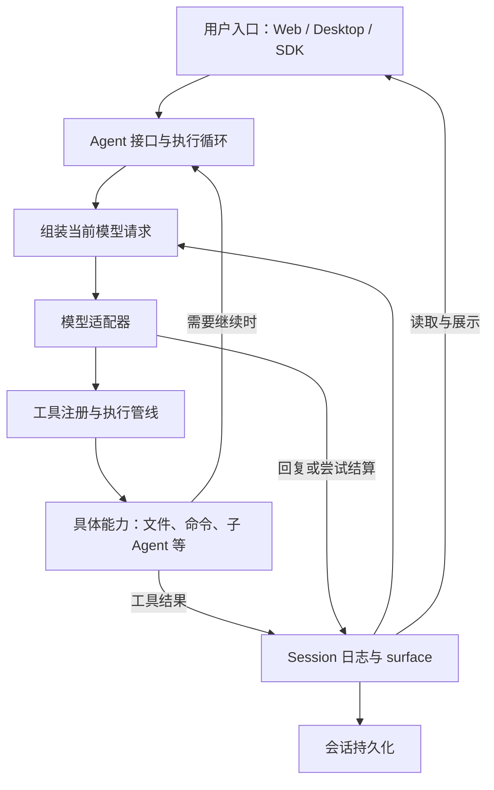

# DSH：从插件化循环到完整应用的演化

> 来源：2026-10-28「设计演化史学习 Skill」的 DSH 讲解。本文按原文保存，仅整理章节标题；日期使用北京时间。研究与验证边界见正文。

我查到的主线是：**DSH 从一开始就选择了插件化的 Agent 循环；后来的关键演化，是逐步解决“怎样保存事实、怎样改变模型上下文、怎样隔离多个 Agent、怎样装配不同应用”，同时删除一些维护成本过高的实现。**

这与“先写一个单体，复杂以后再拆模块”的故事不同。

下面以官方 master 的 `f3803c9` 为“现在”，对应北京时间 **2026 年 10 月 28 日的 `0.2.2-alpha.2`**。我核对了代表性提交的 diff、当时的设计记录及当前架构文档；没有运行历史版本。为便于理解而举的例子属于教学重建，不是开发者真实经历的断言。[当前版本](https://github.com/deepseek-ai/deepseek-harness/commit/f3803c96974ad4a94195fb97e5c637e9c2a3afe3)

我们沿一个任务理解它：**用户让 Agent 查看项目、修改代码、运行测试，并在失败后继续。**

## 先回到 6 月 10—11 日：让“模型调用工具”成为一个可以不断继续的程序。

模型本身只返回输出。让它真正处理任务，还需要一个程序反复做这些事：

> 收到输入 → 整理上下文 → 调用模型 → 执行模型要求的工具 → 把结果交回模型 → 决定继续还是结束。

这就是 *Agent loop*，即执行循环。DSH 最早的 `loop.ts` 只有 205 行，已经包含这条主线，以及流式输出、取消和运行中补充输入等机制。

但作者并没有把模型调用、工具实现、会话数据都写进这个循环。从最早可见的提交开始，就选用了 **Cordis**。你现在可以把它理解成：负责装载插件，让插件提供服务、监听事件，并在卸载时清理自己的注册。

于是最初就有了几种职责：

- `llm`：统一模型调用及返回内容。
- `tools`：登记工具，并安排执行。
- `session`：记录一次会话发生的事情。
- `system-prompt`：组织提示词和工具说明。
- `agent-loop`：把这些能力串成执行过程。

**这里的重大决策，是先确定哪些职责应该能够独立替换。** 新功能尽量通过已有扩展点加入，而不是每加一项能力就修改循环。它的代价也很直接：初学者一开始就要理解服务、事件和插件生命周期。[初始服务包](https://github.com/deepseek-ai/deepseek-harness/commit/d5a1d9bb7599ce58834ac5a1073c2dbc18653451) · [初始执行循环](https://github.com/deepseek-ai/deepseek-harness/commit/43f425827781b95a1b66d7b3121b199e012ab9ad)

## 到了 6 月 13 日，一个具体问题让这种分工落地：模型要求执行 Bash，究竟由谁执行？

最简单的做法，是直接在工具函数里启动本机进程。DSH 当时把它拆成三部分：

| 部分 | 回答的问题 |
|---|---|
| Bash 服务接口 | 执行命令应当接收什么、返回什么？ |
| 本地执行实现 | 怎样启动进程、收集输出、停止进程？ |
| 模型可见的 Bash 工具 | 模型怎样描述执行请求，参数怎样检查？ |

这意味着，模型使用的工具可以通过统一接口调用执行能力，具体执行方式由另一个实现提供。

从这个设计可以看出：将来换执行环境时，有机会保留模型可见的工具和外层循环。但它也增加了接口设计、依赖装配和跨模块排错的成本。**“可替换”是明确的工程选择，并不是免费的灵活性。**

还有一个值得保留的历史边界：这时提交明确把权限和沙箱标为后续工作。不能把今天的完整能力倒推到最初版本。[Bash 三部分的引入](https://github.com/deepseek-ai/deepseek-harness/commit/8b5a3ef7300e5b100c66268f9c761c660172b298)

## 6 月 15 日，问题从“正在运行”扩展到“进程退出以后怎么办”。

DSH 第一版已经用事件日志表示 Session。模型说了什么、调用了什么工具、工具返回什么，都可以成为按顺序追加的事件。但**内存中有日志，不等于程序退出后还能找回来**。

这次变更增加了正式的持久化接口及 JSONL 实现，替换示例程序各自手写的日志保存代码。JSONL 可以简单理解为：用文本文件逐行保存结构化记录。

一个重要选择是：**存储层继续保存已有的 Session 事件，不另造一套含义不同的“数据库会话”。** 这样，运行时、保存、读取和恢复可以围绕同一种事实记录工作。

代价则开始出现：写到一半崩溃怎么办？哪部分已经可靠保存？读到损坏内容怎么办？恢复时怎样处理没有对应结果的工具调用？原本简单的“保存聊天记录”，逐渐变成了对失败状态的明确规定。[正式持久化的引入](https://github.com/deepseek-ai/deepseek-harness/commit/df4b7d3d9adf43bdf913e17b502f042f80379394)

## 6 月 17 日，又出现一个更深的矛盾：需要保存完整历史，却不能永远把完整历史交给模型。

假设 Agent 已经读了二十个文件。为了继续工作，你可能希望用一段摘要代替这些冗长内容。

直接删除旧记录，会损失调查过程；只在发给模型前临时替换消息，又会留下另一个问题：以后恢复会话时，怎样知道模型当时究竟看到了什么？

DSH 因此引入 **Session surface**。可以把它理解成：**根据完整日志，确定“当前哪些内容构成模型上下文”的视图。**

压缩发生时：

- 原始事件仍然留在日志中。
- 新记录说明哪段上下文被摘要替代。
- 后续模型请求根据这个视图生成。
- 重放时，也能重建当时的替换关系。

这里出现了两个需要分开的对象：**历史上发生过的事情，以及当前要让模型看到的内容。** 原始设计记录明确指出，靠各插件临时改写请求，会产生顺序依赖，也缺少持久的修改依据。[Session surface 的原始设计](https://github.com/deepseek-ai/deepseek-harness/blob/c5a1c494e78278710a63257f0af7b64f7b6d9ce2/docs/adr/0019-session-surface.md)

这是理解 DSH 最值得花时间的一个转折：它让上下文压缩、结果裁剪和恢复拥有共同的基础，而不是各写各的特殊逻辑。

## 到 7 月 9 日前后，多 Agent 暴露了“全局插件注册”的局限。

同期设计记录写得很具体：多个 Agent 共用一个 Cordis 环境，但工具、提示词和监听器基本都是全局的。

于是，一个只负责摘要的子 Agent，也可能看到 Bash、文件写入和继续委派的工具；给某个 Agent 写的监听器，如果忘了自行筛选，可能影响所有 Agent。

可以有两种直观修法：

- 每个 Agent 复制一整套服务，但会重复模型适配、存储等共享基础设施。
- 保留全局服务，让所有调用自行检查 Agent 身份，但容易遗漏。

DSH 选择增加 **Agent 自己的注册范围 `agent.ctx`**：部署级能力仍然共享，局部工具、提示词和监听器归属于特定 Agent，并随它结束而清理。

这使“这个工具给谁看”和“它应当活多久”可以由同一处注册决定。它解决的是注册可见性和生命周期；操作系统级的文件、进程隔离仍属于其他机制。[实现变更](https://github.com/deepseek-ai/deepseek-harness/commit/f387b774a9a84d992bb73db6b1db984f971343c3) · [当时的问题与备选方案](https://github.com/deepseek-ai/deepseek-harness/blob/cc24e79cd2b0650880886143a5bf6abdb5840d88/docs/rfc/implemented/architecture/2026-07-08-agent-scope-contexts.md)

## 7 月下旬到 8 月初，重点又变成：怎样把这些能力交付成不同的应用。

7 月 22 日的一批 GUI 变更，明确划分了运行时一侧的 **Host**、界面一侧的 **Client**，以及组合两者的应用入口。设计记录提出的需求包括 Web、无界面执行和未来的 Electron 界面。

原因很好理解：换一个界面，不应该重新实现模型循环、工具和会话；反过来，界面的连接、展示和交互，也不适合塞进执行循环里。

浏览器端随后也采用插件组成界面，并把会话业务状态与 React 展示分开。由此增加了协议、连接恢复、状态同步和前端插件加载等复杂性。[GUI 分层的引入](https://github.com/deepseek-ai/deepseek-harness/commit/a6a3807a07d39c1cd066679a5ccc0d37db65ccb6)

但“代码已经是插件”还不够。如果启动器仍写死加载哪些插件，用户安装第三方扩展时仍要改仓库。

8 月 6 日前后的 **profile 与 bundle** 解决了这层问题：

- **bundle**：可以分发的一组插件及默认配置。
- **profile**：某种运行方式实际选用哪些 bundle，以及用户如何覆盖配置。

因此，Web、headless、SDK 等应用可以共享底层能力，再叠加各自需要的部分。这里的演化是从**代码能够组合**，进一步走向**安装和启动也能够组合**。[Profile 实现](https://github.com/deepseek-ai/deepseek-harness/commit/9235d0f90f1f925ce3013f876f6da178d47afcba) · [问题与设计理由](https://github.com/deepseek-ai/deepseek-harness/blob/f3803c96974ad4a94195fb97e5c637e9c2a3afe3/.agents/notes/implemented/architecture/2026-08-05-profile-plugin-bundles.md)

## 8 月 31 日出现了一次重要的减法：删除 SQLite 会话存储实现。

6 月时，项目增加第二个存储后端，提交标题明确说它用于验证抽象。后来设计记录指出：正式产品使用 JSONL，SQLite 会话存储没有对应的实际部署，却让每次格式、恢复和迁移变化都需要维护第二套实现与测试。

最终决定是：保留可扩展的存储接口，第一方只维护 JSONL 会话存储。SQLite 搜索索引和其他用途仍然保留。

这不是“SQLite 不如文本文件”的普遍结论，而是对具体维护成本和使用需求的取舍。它还带来了明确损失：被删除后端的旧数据库不能由新版本直接打开或迁移。[删除实现及同期理由](https://github.com/deepseek-ai/deepseek-harness/commit/4553c9d957ec09c1e92660ca4d549cfcef84eda9)

这一步很适合修正我们对演化的直觉：**一个抽象曾经值得验证，不代表它的每个实现都值得永久维护。**

## 9 月 2 日，早期“每个流式片段都记一个事件”的选择也被重新审视。

第一版把模型流式返回的片段逐个写成顶层事件，有利于重放和诊断。但会话变长后，存储、传输、索引和界面都需要处理大量小事件。仅压缩文件字节，并没有减少这些消费者要处理的逻辑事件数量。

新的设计以“一次模型尝试”为持久记录单位，把完整流式信息嵌入最终消息或失败尝试记录；实时界面继续接收即时流。

于是，**实时显示需要的粒度，与长期保存需要的组织方式分开了**。失败输出、时序等证据仍然保留在已结算记录中，同时需要承担格式迁移和序号关系转换的复杂性。当前文档也明确：进程在结算前硬退出时，尚未持久化的流可能丢失。[流式记录改造](https://github.com/deepseek-ai/deepseek-harness/commit/f99b06eaed81d6fe4fc64d44687450e18ef68a67)

## 回到现在：这些机制如何共同工作

现在再看 DSH，可以把它读成下面这张职责图。它省略了很多扩展点，但保留了上述演化留下的核心关系：

Profile 决定运行时装入哪些插件；Agent scope 决定某个 Agent 使用哪些局部贡献。当前代码还在发展，但这两层与图中的执行、日志、视图、存储分工，已经能解释相当一部分现有结构。[当前架构](https://github.com/deepseek-ai/deepseek-harness/blob/f3803c96974ad4a94195fb97e5c637e9c2a3afe3/docs/architecture.md)

你可以先用一个问题检查自己有没有抓住其中的关系：**为什么 DSH 需要同时保留完整 Session 日志和 surface？如果压缩上下文时直接删除原来的事件，会失去哪些能力？**
